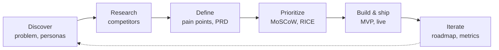
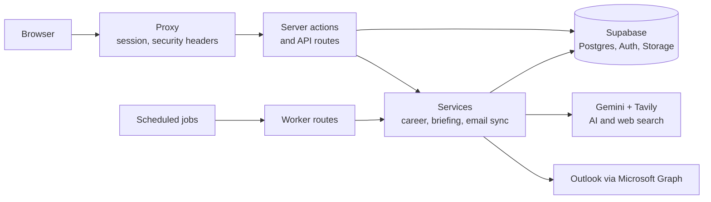

<div align="center">

# Dreamplish

**From the dream to the offer.** A job tracker that researches every company you apply to, checks your fit, tailors your CV and preps you for the interview. In Arabic and English.


**[Live demo → dreamplish.vercel.app](https://dreamplish.vercel.app)** · [Product case study](docs/product/01-problem.md) · [Technical guide](docs/TECHNICAL.md)


</div>

<!-- TODO: add product screenshots or a short GIF (dashboard board, company briefing, Match & CV) to docs/assets/ -->

## The problem

Job seekers apply to dozens of roles. Tracking them is scattered across spreadsheets and inboxes, and researching each company before an interview takes hours, then starts from zero for the next one. Trackers track; they don't help you understand the company. [More →](docs/product/01-problem.md)

## Who it's for

Early- and mid-career job seekers applying to many roles at once, starting with Saudi Arabia and the Gulf: Arabic and English, right-to-left layout, Saudi salary ranges.

## Key features

| Pain point | Feature |
|---|---|
| "I don't know where each application stands" | **Kanban board** with drag and drop and a list view; add and rename your own columns (names translate between Arabic and English) |
| "I forget what happened and what's next" | **Status timeline** per job with dates for every step, plus the **next step** to take |
| "I can't tell what's working" | **Insights panel**: reply rate, follow-ups due and where your applications stand |
| "Am I even a fit for this job?" | **Check my fit**: paste a job or its link and get a requirement-by-requirement match score *before* you apply; unsent checks stay as **drafts** |
| "Copying job descriptions is tedious" | **Description from a link**: fetched from the company's careers page |
| "Which skills am I missing?" | **Match & CV score** for each job, with the skills you're missing |
| "Tailoring my CV is slow" | **Tailored CV** that only uses facts from your CV, even in your own Word design, ready to print as PDF |
| "Researching each company takes hours" | **Company briefing**: news, products, values, in-demand skills, Saudi salary ranges and watch-outs. **Every fact cites its source.** |
| "I walk into interviews unprepared" | **Interview prep**: likely questions and talking points from the job, your CV and the briefing |
| "Updates are buried in my inbox" | **Outlook sync** (read-only) that suggests status updates you approve |
| "Which channel gets me replies?" | **Where you applied**: LinkedIn, company site, referral, recruiter and more, for each job |
| "How much can I still use today?" | **Usage limits**: your remaining daily AI and sync usage on your profile |
| "Is my data safe?" | **Privacy built in**: Google sign-in, data visible only to you, undo on delete and one-click account deletion |
| "Most tools aren't made for Arabic" | **Arabic and English** with full right-to-left layout, plus light and dark mode |

All pain points and the feature for each: [pain points → features](docs/product/03-pain-points.md).

## Why it's different

Huntr, Teal, Simplify and Careerflow focus on tracking, resumes and applying faster. Dreamplish adds **sourced company research tied to each application**, is **built for Arabic speakers**, and is **free, with no ads or tracking**. [Competitor analysis →](docs/product/02-competitor-analysis.md)

## Product process



| Step | Document |
|---|---|
| Discover | [Problem, personas, jobs to be done](docs/product/01-problem.md) |
| Research | [Competitor analysis](docs/product/02-competitor-analysis.md) |
| Define | [Pain points → features](docs/product/03-pain-points.md) · [Lightweight PRD](docs/product/04-solution-and-prd.md) |
| Prioritize | [MoSCoW and RICE](docs/product/05-prioritization.md) |
| Iterate | [Roadmap](docs/product/06-roadmap.md) · [Metrics](docs/product/07-metrics.md) · [Decisions log](docs/product/08-decisions-log.md) |

## Tech stack and architecture

Next.js 16 · TypeScript · Tailwind CSS 4 · Supabase (Postgres with row-level security, Auth, Storage) · Vercel · Gemini · Tavily search · Microsoft Graph. Runs on free tiers.



Detailed diagram: [backend architecture](docs/architecture/backend-architecture.png).

## Roadmap snapshot

| Now (live) | Next | Later |
|---|---|---|
| Tracker, briefings, Match & CV, interview prep, Check my fit, Outlook, Arabic/English | Follow-up reminder emails, export my data, first user interviews | Cover letters, calendar sync, browser job clipper |

[Full roadmap →](docs/product/06-roadmap.md)

## Run locally

```bash
npm install
cp .env.example .env.local   # fill in Supabase, Google sign-in and AI keys
npm run dev                  # http://localhost:3000
```

Full setup (database, Google sign-in, Outlook, scheduled jobs): [technical guide](docs/TECHNICAL.md). Production: [deploy guide](docs/DEPLOY.md).

## My role

I owned the product end to end: discovery, competitor research, product definition, prioritization and the trade-offs in the [decisions log](docs/product/08-decisions-log.md). I built it with AI-assisted development, using Claude Code as my engineering partner, while making the product calls myself.

**Hassan Alsadah**: [LinkedIn](https://www.linkedin.com/in/hassan-alsadah21/) · [hassan.alsadah21@outlook.com](mailto:hassan.alsadah21@outlook.com)
