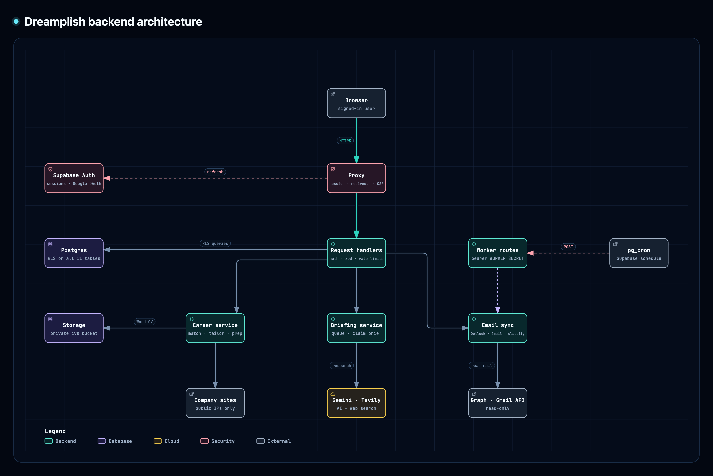

# Dreamplish: technical guide

Setup, architecture and how each feature works. For the product overview, see the [README](../README.md).

**From the dream to the offer.** Track the jobs you apply to and (from Phase 2) get a sourced company briefing before every interview.

Next.js 16 (App Router) · TypeScript · Tailwind CSS 4 · Supabase (Postgres + Auth + RLS) · Arabic & English (RTL/LTR) · light & dark mode.


## Architecture



Requests go through `proxy.ts` (session refresh, auth redirects, a per-request CSP nonce) to server actions and API routes, which check the user, validate input and apply rate limits. Those call the career, briefing and email-sync services, which use Supabase (Auth, Postgres with Row Level Security, and a private Storage bucket for CVs) and the outside APIs. `pg_cron` in Supabase calls the worker routes with a shared secret to drain the briefing queue and sync mailboxes hourly.

[Open the interactive diagram](architecture/backend-architecture.html) (download it and open it in a browser) to zoom, follow connections and jump to the code each part is based on. It was made with the [Archify](https://github.com/tt-a1i/archify) skill from [`backend.archify.json`](architecture/backend.archify.json); after editing that file, regenerate it with `node <archify>/bin/archify.mjs finalize architecture docs/architecture/backend.archify.json docs/architecture/backend-architecture.html --repo-root . --quality showcase` and export a new PNG from the viewer.

## Local setup

### 1. Install

```bash
npm install
```

### 2. Create a Supabase project

1. Go to [supabase.com](https://supabase.com) → **New project**.
2. **SQL Editor** → paste the whole of [`supabase/schema.sql`](../supabase/schema.sql) → **Run** (once, on the empty
   project). It creates every table, policy, function and the private `cvs` storage bucket.
   **Changing the schema later:** edit `supabase/schema.sql` and run the change in the SQL Editor, then
   regenerate the TypeScript types (`npx supabase login` once, then `npm run db:types`; set
   `SUPABASE_PROJECT_ID` for a project other than the default). If the change adds a CHECK-limited or
   JSON column the app reads, add its exact type to `lib/supabase/database.ts`.
3. **Sign-in is Google only:** set up the Google provider as described in *Google sign-in* below, and under **Authentication → Sign In / Providers → Email** turn Email off, so no password accounts can be created.
4. **Authentication → URL Configuration** (Site URL only matters for Supabase's own emails, which the app doesn't use):
   - Site URL: `http://localhost:3000`

### 3. Environment variables

```bash
cp .env.example .env.local
```

| Variable | Where to find it | Exposed to browser? |
|---|---|---|
| `NEXT_PUBLIC_SUPABASE_URL` | Project Settings → Data API | yes (safe) |
| `NEXT_PUBLIC_SUPABASE_PUBLISHABLE_KEY` | Project Settings → API Keys → publishable key (or legacy anon key) | yes (safe — RLS protects data) |
| `NEXT_PUBLIC_SITE_URL` | Your app URL, used in auth emails | yes |

Server-only (never prefix with `NEXT_PUBLIC_`):

| Variable | Purpose |
|---|---|
| `SUPABASE_SECRET_KEY` | Project Settings → API Keys → secret key. Server only: briefing and email workers, email sync, rate limits, account deletion. |
| `AI_PROVIDER` | `mock` (sample data), `tavily` (free tiers: Tavily search + Gemini) or `gemini` (built-in Google Search, needs billing) |
| `GEMINI_API_KEY` | From [Google AI Studio](https://aistudio.google.com/apikey); needed for `tavily` and `gemini` |
| `GEMINI_MODEL` / `GEMINI_FALLBACK_MODEL` | Default `gemini-3.5-flash-lite` (fast on the free tier), falling back to `gemini-3.8-flash` when the first model is busy or too slow |
| `TAVILY_API_KEY` | From [app.tavily.com](https://app.tavily.com) (1,000 free searches/month); needed for `tavily` |
| `WORKER_SECRET` | Protects `/api/worker/briefs`; `openssl rand -hex 32` |
| `BRIEFS_DAILY_LIMIT` | Briefing generations per user per 24h (default 10) |
| `AI_DAILY_LIMIT` | Analyze / tailor / prep runs per user per 24h (default 30) |
| `OUTLOOK_CLIENT_ID` / `OUTLOOK_CLIENT_SECRET` | Azure app registration for the Outlook integration (optional, see below) |
| `GMAIL_CLIENT_ID` / `GMAIL_CLIENT_SECRET` | Google Cloud OAuth client for the Gmail integration (optional, see below) |
| `EMAIL_TOKEN_KEY` | Encrypts stored Outlook / Gmail refresh tokens; `openssl rand -hex 32` |

> Gemini free tier: Google may use prompts and outputs to improve its products, and Google Search grounding isn't included — that's why the free setup uses Tavily for search. Use a paid key in production.

### 4. Run

```bash
npm run dev
```

Open http://localhost:3000.

## Google sign-in

Google is the only way to sign in (the first sign-in creates the account), so the app needs this before anyone can use it.

1. [Google Cloud Console](https://console.cloud.google.com) → new project → **Google Auth Platform**: app name, **External** audience, add yourself as a test user. Under **Branding**, add the home page, `/privacy` and `/terms` links, and both your site's domain and `<project-ref>.supabase.co` as **Authorized domains**. Ask only for the basic scopes (email, profile, openid) so no Google review is needed.
2. **Clients → Create client → Web application**
   - Authorized JavaScript origins: `http://localhost:3000` (plus your live domain)
   - Authorized redirect URIs: `http://localhost:3000/api/auth/google/callback` (plus `https://<your-domain>/api/auth/google/callback`)
3. Put the Client ID (`…apps.googleusercontent.com`) and Client Secret (`GOCSPX-…`) in `.env.local` (and Vercel) as `GOOGLE_CLIENT_ID` / `GOOGLE_CLIENT_SECRET`.
4. Supabase → **Authentication → Sign In / Providers → Google**: enable it and paste the same Client ID (also under **Authorized Client IDs**, if shown) and secret, so Supabase accepts the ID tokens the app hands it.

The app runs the Google sign-in itself (`/api/auth/google`, OAuth code flow with PKCE, state and nonce) and passes Google's ID token to Supabase (`signInWithIdToken`). That's why Google's screen names your site instead of the Supabase project.
5. Before launch: **Audience → Publish app** so any Google account can sign in. To show the name "Dreamplish" (and a logo) instead of the address, request **brand verification** under Branding.

## Outlook email integration (optional)

Reads job emails from the user's Outlook inbox **and Sent folder** and suggests new jobs and status changes on the dashboard, using a
fixed set of columns: **Application**, **Assessment**, **Interview**, **Offer** and **Rejected**. For assessments and
interviews the type is captured too ("Technical interview", "HackerRank coding test") and shown in small text on the job.
When a job is already in Assessment or Interview and an email names a new type (e.g. HR interview → Technical
interview), it's suggested as a **new round**; the same type again is treated as a reminder and skipped.
In the **Sent folder**, emails that look like applications (CV attached, "applying for…", Arabic too) are classified as
applications to the company you wrote to (first sync looks back 90 days); follow-ups and thank-you notes are ignored. An
application you emailed and the company's reply in the same sync become one suggestion, marked *Sent by you*.
Likely job emails are read in full on the server to find the **job posting link** (LinkedIn job links without tracking, and
common hiring sites such as Greenhouse, Lever and Workday), the **role** (in LinkedIn emails it's the link text) and a **job
description** when the email contains one; these are added to the job when the suggestion is accepted. Job pages on LinkedIn
are never fetched. **Update jobs from past emails** (Profile → Email) re-reads emails already turned into suggestions
(last 60) and fills in links, roles and descriptions that are still empty, plus "Unknown role" titles. A LinkedIn confirmation and the company's own email about the same application become one suggestion.
Email never moves jobs into the user's manual columns. Read-only; nothing changes until the user accepts a suggestion.

1. **Give your Microsoft account an Azure directory** (one time, free). Personal outlook.com accounts have none
   by default, which shows up as *"account does not exist in tenant 'Microsoft Services'"*. Sign up for
   [Azure for Students](https://signup.azure.com/studentverification?offerType=1) (no card) or a
   [free Azure account](https://signup.azure.com/signup?offer=ms-azr-0044p), choosing **Personal account**.
   University / work accounts are often blocked from registering apps ("you have no access").
2. [Entra admin center](https://entra.microsoft.com) → **Applications → App registrations → New registration**
   - Supported account types: **Personal Microsoft accounts only**
   - Redirect URI (Web): `http://localhost:3000/api/email/outlook/callback` (add your production URL later)
3. Copy the **Application (client) ID**; **Certificates & secrets → New client secret** → copy the **Value**.
4. **API permissions → Microsoft Graph → Delegated**: `Mail.Read`, `User.Read`, `offline_access`.
5. Set `OUTLOOK_CLIENT_ID`, `OUTLOOK_CLIENT_SECRET` and `EMAIL_TOKEN_KEY` in `.env.local`.
6. In the app: **Profile → Email — Outlook → Connect Outlook**.

Locally the inbox is checked when the dashboard opens and the last check is over an hour old, or with **Sync now**.
In production, schedule the worker hourly (see *Scheduled jobs* below).

## Gmail integration (optional)

Works like Outlook, sharing the same suggestions, Sent-folder reading, job links and "Update jobs from past emails". You can connect Outlook, Gmail or both (one of each). Access is read-only (`gmail.readonly`). The first sync uses Gmail's own search to fetch only likely job emails (application, interview, offer, CV… in the last 30 days of the inbox and 90 days of Sent). After that it only reads messages added since the last sync, using Gmail's history id.

1. [Google Cloud Console](https://console.cloud.google.com): use your existing project (the one for Google sign-in is fine) → **APIs & Services → Library → Gmail API → Enable**.
2. **Google Auth Platform → Data access → Add or remove scopes**: add `https://www.googleapis.com/auth/gmail.readonly`. **Audience**: keep **Testing** and add your Gmail address as a test user.
3. **Clients → Create client → Web application** (or edit your existing one), with the authorized redirect URI `http://localhost:3000/api/email/gmail/callback` (add your production URL later).
4. Put the client ID and secret in `.env.local` as `GMAIL_CLIENT_ID` / `GMAIL_CLIENT_SECRET` (you can reuse the Google sign-in client). Restart the dev server.
5. In the app: **Profile → Email → Connect Gmail**.

> **Testing mode limits.** Gmail reading is a *restricted* Google scope. While the app is in Testing, up to 100 test users can connect, but Google expires the connection after **7 days**, so the card shows an error and you click Connect Gmail again. Publishing it for everyone needs Google's verification, including a third-party security assessment.

## Project structure

```
app/
  (public)/            landing, sign-in (Google), privacy, terms
  (app)/               signed-in area: dashboard, jobs/new, jobs/check (Check my fit), jobs/[id], profile
components/
  ui/                  Button, Field/Input/Select/Textarea, Card, Alert, Toast (with Undo), Breadcrumbs
  layout/              TopBar (full width: logo, Add job, toggles, account menu), AddJobLink, NavPills (signed-out pages), AccountMenu, Logo, theme & language toggles
  jobs/                Dashboard, KanbanBoard, JobList, JobForm, BoardCustomizer, delete dialogs,
                       StatusTimeline (+ TimelineNode / Connector / Tooltip, edit-date dialog)
  briefing/            briefing page panel and job-page card
  career/              Match & CV, skill check, tailored CV (+ PDF sheet), interview prep
  email/               Outlook settings card, "From your inbox" suggestions
lib/
  actions/             Server Actions (auth, jobs, board columns, history, profile, preferences, account deletion, job description lookup)
  api/                 shared API route helpers (auth + row id check, JSON body, error → HTTP status)
  schemas/             Zod validation shared by client and server
  i18n/                en/ar dictionaries, locale helpers
  supabase/            server client, admin (service-role) client, proxy session refresh
  briefing/            briefing queue, worker, providers (mock / tavily / gemini), source rules
  career/              job analysis, skill check, CV tailoring (text + .docx), interview prep, job description lookup
  email/               Outlook (Graph) and Gmail OAuth + sync, email pre-filter + AI classification, job matching
  ai/                  Gemini helper, CV redaction
  safe-fetch.ts        fetching public pages safely (used by briefings and job description lookup)
  safe-url.ts          only http(s) links from AI output or emails are rendered
  security-headers.ts  security headers and the per-request Content-Security-Policy
  rate-limit.ts        per-user limits for AI tools, email sync, paid searches and link reads
  stage-names.ts       English/Arabic names for custom board columns (phrasebook, then Gemini)
  stages.ts            board columns: defaults, labels, colours, which column a job is in
  history.ts           status history helpers (move kind, labels, colours, relative time)
  motion.ts            shared animation timings, easings and springs (used by the timeline)
  dal.ts               data access layer (verified user, jobs, profile, board columns)
proxy.ts               refreshes the auth session, redirects signed-out users
supabase/schema.sql    SQL schema + Row Level Security (one file)
lib/supabase/          Supabase clients; database.types.ts (generated) + database.ts (app overrides)
docs/architecture/     backend architecture diagram (PNG + interactive HTML + its Archify source)
supabase/tests/        SQL checks to paste into the SQL Editor (run in a rolled-back transaction)
tests/                 Vitest + Testing Library tests
.claude/skills/        Claude Code skills used while building (animate)
design/                reference designs
```

## How it works

- **Auth**: Google sign-in only (no passwords; the first sign-in creates the account). The app runs the OAuth flow on its own domain (`app/api/auth/google`, `lib/google-sign-in.ts`) and hands Google's ID token to Supabase, which owns accounts and sessions. `proxy.ts` (Next 16's replacement for `middleware.ts`) refreshes the session cookie and redirects. Every page and action re-checks the user through `lib/dal.ts`.
- **Security**: Row Level Security on every table, so users can only read their own jobs and profile. Companies are shared but only visible when linked to one of your jobs, and are created through the `get_or_create_company` function, which removes duplicates by normalized name. Internal database helpers can't be called by signed-in users.
  - **Headers** (`lib/security-headers.ts`): every response sends `nosniff`, a strict referrer policy, `X-Frame-Options: DENY`, a permissions policy and (in production) HSTS. Pages also get a Content-Security-Policy with a fresh nonce per request, set by the proxy: scripts only run with the nonce, and the app can't be framed.
  - **Fetching user-supplied URLs** (`lib/safe-fetch.ts`): only public addresses, checked inside the connection's own DNS lookup (so DNS rebinding can't swap in an internal address), every redirect re-checked, 8-second limit, 1.5 MB cap.
  - **Rate limits** (`lib/rate-limit.ts`, stored in `ai_requests`): the AI tools share `AI_DAILY_LIMIT` per day; *Sync now* 12 an hour; re-reading past emails 3 a day; *Find job description* 30 a day; reading a pasted link 60 an hour.
  - **Links from AI output or emails** are only shown if they're `http(s)` (`lib/safe-url.ts`).
  - **Deleting your account** (Profile): type your email to confirm. Your CV files are removed, then the account, which deletes everything else through the database's cascades.
- **Validation**: Zod schemas run on the server for every action. The database also has length, URL and enum constraints.
- **Languages**: the locale is stored in the `dreamplish-locale` cookie, falling back to `Accept-Language`. `<html lang dir>` is set on the server. Layouts use logical CSS properties (`ms-`, `pe-`, `start-`), so RTL needs no separate styles. Dates use the Gregorian calendar with Latin digits in Arabic.
- **Theme**: `next-themes` with a `.dark` class. Colors are CSS variables in `app/globals.css`.
- **Design system**: all tokens live in `app/globals.css` for both themes.
  - **Chrome:** the top bar is white with a hairline border in light mode and black in dark mode. Primary buttons are black (near-white in dark mode) on neutral greys, with an indigo accent for links, selection and focus. Toasts stay black in both themes.
  - **Colour:** the six job statuses carry the colour (slate, sky, violet, amber, emerald, rose, each with an icon and a label, never colour alone). Both theme sets pass a colour-blind separation check.
  - **Dawn gradient:** violet → rose → amber, used at one focal point per screen. Buttons use a violet → deep-rose version so white text stays ≥ 5.4:1.
  - **Contrast:** every text pair is WCAG AA in light and dark.
  - **Fonts:** Bricolage Grotesque (English) and Alexandria (Arabic) for headings, IBM Plex Sans Arabic for body text, and Amiri for the kashida wordmark, all via `next/font`.
  - **Shared components** in `components/ui`: Button (incl. the `dawn` variant), Card (`interactive` lift tinted by status), Field, Alert, Toast (with Undo), Skeleton, EmptyState, TabLinks, Breadcrumbs.
- **Motion**: timings live in `lib/motion.ts`, mirrored in CSS (`--dur-*`, `--ease-*`).
  - Page entrances, list staggers and the landing reveal are pure CSS, so content is visible before scripts load.
  - Only transform and opacity animate, and every animation falls back to a short fade (or nothing) under *Reduce motion*.
  - The landing reveal plays once and doesn't loop.
- **Layout**: full screen width, with only an edge margin (16–32px) and no centred maximum width. The top bar (`components/layout/top-bar.tsx`) has the logo at the start edge (right in Arabic) and, at the end edge, Add job, the language and theme toggles, and the account menu. Signed-out pages show Log in / Sign up in the centre. On phones it's a single row. Signed-in pages use the whole width, so the dashboard board has more room and the insights panel sits at the edge. Form pages (Add job, Profile) keep their own reading width in the middle.
- **Company briefings**: generated only when a user clicks *Generate briefing*, then cached per company for 7 days (manual refresh allowed once an hour, with a daily per-user limit). `company_briefs` doubles as the job queue (`pending → generating → ready | failed`); `claim_brief()` locks a row with `FOR UPDATE SKIP LOCKED`, and the work runs in Next's `after()` so the request returns immediately. Stalled jobs restart when the briefing page polls, so no cron is needed locally.
- **No guesses**: search results (Tavily, or Gemini's Google Search grounding) are numbered, and the model writes JSON where each fact can only cite those numbers — so every URL comes from a real search result. A Tavily brief uses 4–7 searches. Facts without a source, LinkedIn/Glassdoor sources and news older than ~3 months are dropped; empty sections show "Not found". Salary confidence is capped by the number of sources. Google's search-suggestion widget is shown as its terms require.
- **Briefing sections**: overview, news (3 months), products, values, skills, Saudi salary for the user's roles, **Watch-outs** (layoffs, legal, financial, workplace, leadership and reputation issues from reputable news in the last 24 months, each with a status label — reported / alleged / confirmed — and an interview question), and **The role at this company** (duties from the company's own postings for the same kind of job, public team work, tools, and a LinkedIn people-search link the user opens themselves).
- **Briefing accuracy rules**: the official website must match the company name; LinkedIn is read from the company's own website, never guessed; salary, watch-outs and role duties must quote a source that names the company; role duties must come from a posting of the same kind of job (e.g. Developer ≈ Engineer, not Project Manager); forums and social media are excluded as sources. Website fetching is limited to public hosts.
- **Career tools** (job page tabs): *Match & CV* extracts requirements from the job description (each must quote the posting) and matches them to the CV (each match must quote the CV); the score is computed by the app — must-haves 70%, nice-to-haves 30%. *Tailored CV* rewrites the CV for the job using only facts already in it, lists suggestions separately, and flags any number not in the original. *Interview prep* builds questions and talking points from the job, CV and company briefing.
- **Check my fit** (dashboard button, `/jobs/check`): run Match & CV and tailor your CV *before* applying, when it still changes what you send.
  - Paste the posting link; the description, role and company fill in when the page can be read. *Check match* opens that job's Match & CV tab: the same score, skill check and tailored CV as on any job.
  - The job is kept as a draft (status Saved) and stays off the board, list and insights while the Saved column is hidden. Drafts are kept until you apply or delete them.
  - **Checked, not applied** (dashboard strip): your drafts with their match score; each opens on Match & CV.
  - **I applied** (on the strip and a draft's job page): moves the job to the top of Application, dated today in your time zone (a date you already set is kept). Its match and tailored CV stay with it.
- **Tailored CV in the user's own design**: uploaded CVs are kept in a private Storage bucket (`cvs/{user_id}/…`, RLS per user). For Word files, tailoring rewrites the document paragraph by paragraph (same count and order) and `lib/career/docx.ts` writes the new text back into the original `.docx`, so fonts, colours and layout are unchanged. Other CVs export to PDF via a print view with Classic / Modern / Compact layouts.
- **CV privacy**: name, email, phone numbers and links are replaced with placeholders before CV text is sent to Gemini and restored afterwards (`lib/ai/redact.ts`). CV uploads (PDF/DOCX/TXT, 5 MB) are converted to text server-side; the original file is kept in the user's private storage folder so tailored Word CVs can reuse its design.
- **Email integration**: Microsoft or Google OAuth (PKCE, read-only scopes), one connection per provider. Refresh tokens are encrypted with AES-256-GCM and never sent to the browser. Each sync goes through every connected mailbox: Outlook uses Graph delta queries, and Gmail uses a first search for likely job emails and then its history id (`lib/email/gmail.ts` maps Gmail messages to the same shape, with ids prefixed `gmail:`). A mailbox that fails (e.g. expired Gmail access) is marked with its error while the others still sync. After that come a free keyword/sender pre-filter, then the body of each likely job email is read (`lib/email/body.ts`: plain text, job link, description) and Gemini classifies it from the subject, sender and the first ~1,500 characters with email addresses, phone numbers and links removed. Suggestions match existing jobs by company and kind of role, never move a status backwards, and are applied only when accepted. Only the job link and an in-email job description are stored (on the suggestion, then the job); full emails are never stored.
- **Board columns** (`board_stages`, `lib/stages.ts`): every user starts with the fixed email columns — Rejected (first), Application, Assessment, Interview, Offer — plus Saved, hidden by default. *Customize board* adds manual columns (name + colour, e.g. "Called"), renames (clearing restores the default name), recolours, reorders, hides, and deletes manual columns after choosing where their jobs go; fixed columns can't be deleted. Up to 12 columns. A job's `status` always stays one of the five core statuses: fixed columns map directly, and a manual column takes the status of the nearest fixed column to its left, so filters, scores and email rules keep working. `jobs.stage_id` null means "the core column of my status", so jobs created before the feature stay put.
- **Dashboard layout**:
  - **Top bar:** one way to each place. The logo goes to the dashboard, **+ Add job** is in the top bar on every page (icon only on phones), and your name, Profile and Log out are in the avatar menu. There are no separate menu pills, so phones get a single-row top bar.
  - **Inbox card:** "From your inbox" shrinks to a one-line strip when there's nothing to review.
  - **Toolbar:** search, column and view sit in one compact row, with a job count.
  - **Board columns:** they're only as tall as their cards (all stretch while dragging, so drops are easy). Empty columns are narrower, and any column can be collapsed to a slim strip (Rejected starts collapsed; your choice is remembered in this browser). A collapsed column still accepts drops.
  - **Cards:** they show the interview or assessment type, a How you applied icon, and an amber "Waiting N d" badge after 14 days at Applied with no change.
  - **Phones:** the board shows one column at a time, chosen from a row of tabs. Dragging a card onto a tab moves it to that column.
- **Breadcrumbs** (`components/ui/breadcrumbs.tsx`): deeper pages show where you are and the way back, replacing the old "Back" links. The arrows flip in Arabic, and long names are cut short (full name on hover). Each item takes only the room it needs, so the trail stays together at the start of the line. Each user-typed name (company, role) is wrapped in `<bdi>` (`withNames()`), so an Arabic company name on an English page (or the reverse) keeps its own direction and doesn't reorder the trail. The briefing page ends with a plain translated "Company briefing" label, not "<name> briefing", so an English word is never glued to an Arabic name.
  - **Job:** Your applications › company – role (one item, e.g. "Abyan Capital – Software Engineering")
  - **Company briefing:** Your applications › company – role (the job you came from) › Company briefing; opened directly, Your applications › company
  - **Add job / Profile:** Your applications › page
- **Undo instead of confirmations**: deleting a job (board, list or job page) removes it at once and shows **Undo** for 6 seconds. The server delete runs after that, or when you leave the dashboard. If it fails, the job comes back with a message.
- **Accepting several suggestions**: with more than one inbox suggestion, tick them (or *Select the confident ones*) and *Accept selected*. They're accepted one after another, as they are; any that fail are reported.
- **Next step** (job page, `lib/next-step.ts`): one line saying what to do now, in priority order:
  - closed (rejected) or an offer;
  - no job description;
  - not applied yet: check your match and tailor your CV before applying (once matched: *Tailor CV*, then *I applied*);
  - assessment or interview stage, linking to Match & CV or Interview prep;
  - 14+ days without a reply, suggesting a follow-up;
  - otherwise waiting, suggesting Match & CV (to know your gaps before an interview) if it hasn't been run.
- **Keyboard shortcuts** (dashboard, not while typing): `/` search, `N` new job, `B` board, `L` list.
- **Kanban ordering**: each job has a fractional `position`. A drag writes only the moved row, with an optimistic update that rolls back on error. Dragging a job to a different column clears its email interview/assessment type. The drop target is whatever is under the pointer (`components/jobs/board-collision.ts`): the card there decides the order, and an empty column catches the drop even though it stretches to the height of the tallest column. Corner distance is only a fallback for keyboard dragging.
- **Status history** (`job_status_history`, job page): a trigger on `jobs` writes a row in the same transaction whenever a job is created or its status or board column changes, so the history can't drift from the job. The column name is copied into the row, so renaming a column later doesn't rewrite history, and an email's interview/assessment type becomes the row's note. A new interview/assessment type on a job that stays in the same column (an accepted email round) also writes a row; clearing the type doesn't. Clients can only read and insert their own rows (no update/delete policies). The one exception is `set_status_change_date()`, which edits a row's date and note when a change is logged after the fact: own rows only, never in the future, and not before the job was created unless the user confirms. Existing jobs were backfilled with one row dated when they were applied to. The application point always matches the job's **Date applied**: a new job's first point is dated on it, changing Date applied moves the point, and editing that point's date on the timeline updates Date applied. A date with no time uses the time the job was added if it's the same day, otherwise midday UTC so the calendar day is the same in almost every time zone.
- **Timeline**: a commit-graph on the start side of the job page (sticky on desktop, compact above the tabs on mobile, showing the last 4 with *Show all*). One SVG line through measured node centres draws itself with `stroke-dashoffset`. Moves backwards (e.g. Interview → Application) or sideways (into another column) bend into a curve, mirrored in Arabic. Repeated rounds in the same column stay on the straight line and are labelled *Interview · Round 2*, *Round 3*. **Add step** (any phase) logs what happened in two levels: the kind — *Call*, *Assessment* or *Interview* — then its type (quick picks such as HR call, Coding test, Technical interview, or your own), plus a date and note. An Assessment or Interview step also moves the job to that column unless it's already there; a Call never moves it. `add_job_step()` updates the job and writes a single history row in one transaction, and the same type twice is allowed. Steps show as *Call — Recruiter screen* or *Interview · Round 2 — Technical interview* (rounds counted per kind), with a phone, clipboard or chat icon. Nodes have per-status colours and icons, the current one is larger with a pulsing ring, Offer glows and Rejected is a muted red. Each node shows relative time with the exact date on hover/focus, and a hover/focus card shows the previous status and note. After a status change only the new node animates and the line extends to it. Animations use the `motion` library, with every timing in `lib/motion.ts`, and only transform, opacity and stroke offset animate. With *Reduce motion* turned on everything becomes a short fade. The timeline streams in with a skeleton.
- **Description from a pasted link**: in the job form, pasting a job link (or leaving the link field) while the description is empty reads the posting from that link only, with no search, using the same site rules and structured-data checks as below, and fills the description (plus an empty role or company). Nothing is saved until the form is, and a description the user typed is never replaced. LinkedIn and Glassdoor links get a message instead of being read.
- **Finding a job description** (`lib/career/find-description.ts`, `lib/career/job-posting.ts`): when a job has none, *Find job description* (job page), accepting an email suggestion, and the email re-read look for the posting online. The job's own link is tried first, then one Tavily search. Pages are only used from the company's own site, an employer careers site (`careers.…` / `jobs.…`, e.g. a parent company's) or a hiring system (Greenhouse, Lever, Workday, SmartRecruiters…); LinkedIn, Glassdoor and job boards are never used. The description comes only from the page's structured job data (schema.org `JobPosting`), and only when the title is the same role and the company is the hiring organisation or named in the description. Nothing is saved otherwise. The saved text starts with `Source: <url>` and never replaces a description the user already has. Pages are fetched with `lib/safe-fetch.ts` (public hosts only, redirects re-checked, size and time limits).
- **How you applied** (`jobs.applied_via`, `applied_via_detail`): LinkedIn, company website, email, WhatsApp, referral, job board, recruiter, in person or other, plus a short detail ("WhatsApp to Ahmed, HR"). Set in the job form and shown in a *How you applied* section on the job page (and next to the date applied). Email suggestions fill it in when they can tell: a LinkedIn confirmation → LinkedIn, a job board → job board, a hiring system or the company's own address → company website, an application in the Sent folder → email. Only application confirmations count, and an existing value is never replaced.
- **Dashboard insights** (`lib/insights.ts`, `components/jobs/insights-panel.tsx`): a panel to the right of the board (below it on smaller screens), computed from the jobs and their status history. It shows:
  - **Reply rate**: applications (anything not Saved) that got a call, assessment, interview, offer or rejection.
  - **Reached an interview**, and the median time to the first reply.
  - **Pipeline**: jobs per board column, in board order and colours.
  - **Waiting for a reply**: still at Applied with no change for 14+ days, oldest first.
  - **Applications per week** for the last 8 weeks.
  - **Reply rate by how you applied**, with a note when the numbers are small.
  - **Recent events.**

  Rates are blank, not 0%, before any application. On load the reply rate counts up, the pipeline strip fills and the weekly bars rise, using transform only, with timings in `lib/motion.ts`. Reduce motion shows the final state at once.
- **Deleting jobs**: from the job page, or from the dashboard (trash button on each card / row, confirmation dialog, optimistic removal that's restored if the server refuses).

## Scripts

```bash
npm run dev      # dev server
npm run build    # production build
npm run lint     # ESLint
npm test         # Vitest tests (components, server actions, security)
npm run db:types # regenerate lib/supabase/database.types.ts from your Supabase project
```

## Tests

- `npm test` runs the Vitest tests in `tests/` (timeline renders one node per change, the empty state, Arabic labels, move kinds and round labels, the Add step dialog, email round suggestions, reading job links / roles / descriptions from email HTML, job posting pages (structured data, company/role checks, allowed sites), the job form filling the description from a pasted link, next step rules, dashboard insights (rates, follow-ups, weekly buckets, channels, recent steps), how-you-applied (email channel detection, Sent-folder filter, form validation, the job page section), the board's drop target (empty columns accept drops), and the change-date validation). Server actions are tested against a fake Supabase client that records every query (`tests/fake-supabase.ts`): jobs, board columns, history, accepting email suggestions and account deletion. Security tests cover the URL fetcher (a local server must be unreachable by name, IP, IPv6, decimal/hex forms or redirect), rate limits and link filtering.
- Database: paste [`supabase/tests/job_status_history.test.sql`](../supabase/tests/job_status_history.test.sql) into the SQL Editor and run it after `supabase/schema.sql`. It checks that creating a job writes 1 history row, a status change adds exactly 1 more, other edits add none, a new interview type adds a round (the same type again or clearing it adds none), the application point follows Date applied both ways, adding steps by hand writes exactly one row each, moves the job only for Assessment/Interview steps and refuses future dates, and every job has history. It prints *ALL HISTORY TESTS PASSED* and rolls everything back.

## Scheduled jobs in production (optional)

Briefings normally run straight after the click, and the inbox is checked when the dashboard opens. In production,
schedule both workers, for example from Supabase (**Database → Extensions**: enable `pg_cron` and `pg_net`, then run
in the SQL Editor). Vercel's free plan only allows daily cron jobs, so Supabase does the timing.

```sql
select cron.schedule('dreamplish-briefs', '*/5 * * * *', $$
  select net.http_post(
    url := 'https://<your-domain>/api/worker/briefs',
    headers := jsonb_build_object('Authorization', 'Bearer <WORKER_SECRET>')
  );
$$);

-- Outlook inbox check for all connected users, every hour
select cron.schedule('dreamplish-email', '0 * * * *', $$
  select net.http_post(
    url := 'https://<your-domain>/api/worker/email',
    headers := jsonb_build_object('Authorization', 'Bearer <WORKER_SECRET>')
  );
$$);
```

## Deploy (Vercel)

**See [docs/DEPLOY.md](DEPLOY.md)** for the full production guide: Supabase settings, Vercel plan and environment variables, AI keys and data use, Gmail's review process, and a post-deploy checklist. The short version:

1. Push the repo to GitHub and import it in Vercel.
2. Add the environment variables from `.env.example` (set `NEXT_PUBLIC_SITE_URL` to your Vercel URL).
3. In Google Cloud, add `https://<your-domain>/api/auth/google/callback` as a redirect URI of the sign-in client.
4. If you use the Outlook integration: in the Azure app registration → **Authentication**, add the redirect URI
   `https://<your-domain>/api/email/outlook/callback`, and schedule the hourly email worker (see *Scheduled jobs*).
